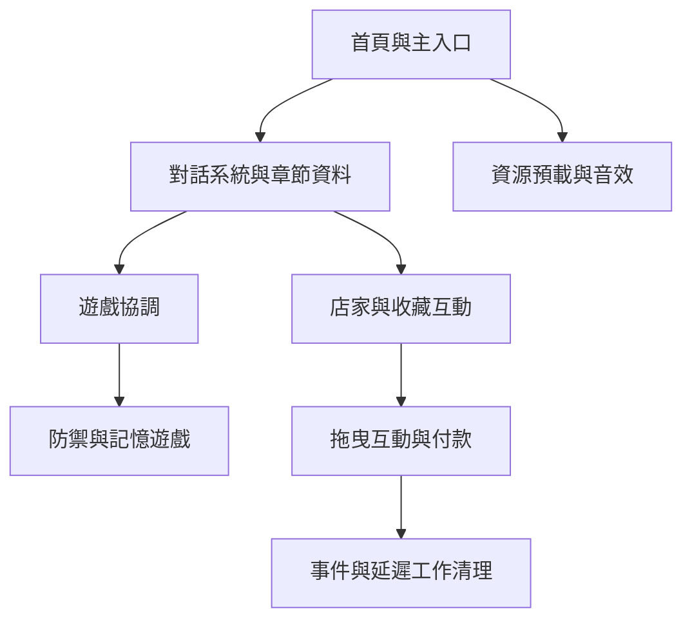

# 北斗紅磚市場的微光記憶

透過故事對話與互動小遊戲，探索北斗紅磚市場的人物、店家與地方記憶。


作者：王笙倍

## 遊戲特色

- **小朋友版**：故事文字搭配注音字型及較簡單的引導。
- **一般版**：標準文字與完整劇情。
- **三章故事**：結合防禦挑戰、記憶配對、知識問答、物品拖曳與銅板付款。
- **橫向 16:9 舞台**：保持場景構圖，依裝置可用範圍縮放並避開手機安全區域。
- **章節紀錄**：完成紀錄保存在目前瀏覽器；關卡選單可重設。尚不支援對話或小遊戲中途續玩。
- **PWA 配置**：含安裝與快取設定；完整離線資源涵蓋範圍仍待驗證。

## 在電腦上執行

不需要安裝前端框架或編譯專案。

1. 使用 GitHub Desktop 下載專案，並切換至要測試的分支。
2. 用 VS Code 開啟專案資料夾。
3. 安裝 Live Server 擴充套件。
4. 在 `index.html` 按右鍵，選擇 **Open with Live Server**。
5. 選擇遊戲模式，進入市場。

請使用本機網頁伺服器，避免直接雙擊 HTML。遊戲建議橫向操作。
PWA 的路徑目前設定為 `/GAME/`，本機 Live Server 可用於一般遊玩測試；
PWA 安裝、快取更新及離線行為需要在對應網站路徑下另外驗證。

## 專案結構

```text
index.html             網頁入口與畫面容器
style.css、css/        場景、小遊戲與跨裝置樣式
js/core/               對話、打字、音效、資源載入與遊戲協調
js/data/               各模式章節、問答題庫與資源清單
js/minigames/          各款小遊戲與互動系統
assets/                圖片、字型、音效與影片
tests/                 回歸測試與本機版面檢查工具
docs/IMPROVEMENTS.md   改進紀錄與已知限制
sw.js、manifest.json   PWA 設定
```



目前仍使用依序載入的原生 JavaScript，並非完整 ES Modules 架構。
`MinigameSession` 為互動與付款系統管理一次遊玩的全域事件、延遲工作及外掛提示畫面。

## 開發驗證

若已安裝 Node.js，可在專案根目錄執行：

```sh
node --test tests/regressions.cjs tests/lifecycle.test.cjs
node tests/serve-layout.cjs
```

預覽網址：`http://127.0.0.1:4173/preview?w=844&h=390&scene=quiz&safe=1`。
可切換 `age`、`menu`、`dialogue`、`quiz`、`defense`、`memory` 場景；
`scene=cleanup` 會執行互動／付款反覆開關及拖曳退出的檢查。
這些測試工具與 `docs` 不影響正式遊戲啟動；`js`、`css` 與入口引用的資源則需要保留。

## 已知限制與下一步

- 手機直向仍提示改為橫向，不是完整直向介面。
- 實體手機、Safari、完整離線及遊玩中旋轉螢幕仍需持續測試。
- 本輪清理集中於拖曳互動與付款；防禦、記憶及其他場景的延遲動畫仍需逐項檢查。
- 無障礙後續重點是鍵盤可操作性、焦點提示、字體及對比，尚未宣稱符合完整無障礙標準。

## 素材與授權

字型授權與聲明位於 `assets/fonts/`。其他素材的來源及使用授權應由作者補充；
本專案未額外宣告整體開源授權。
